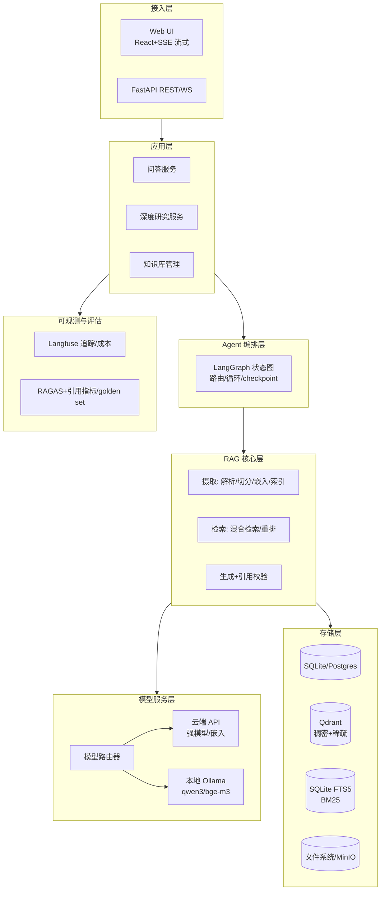
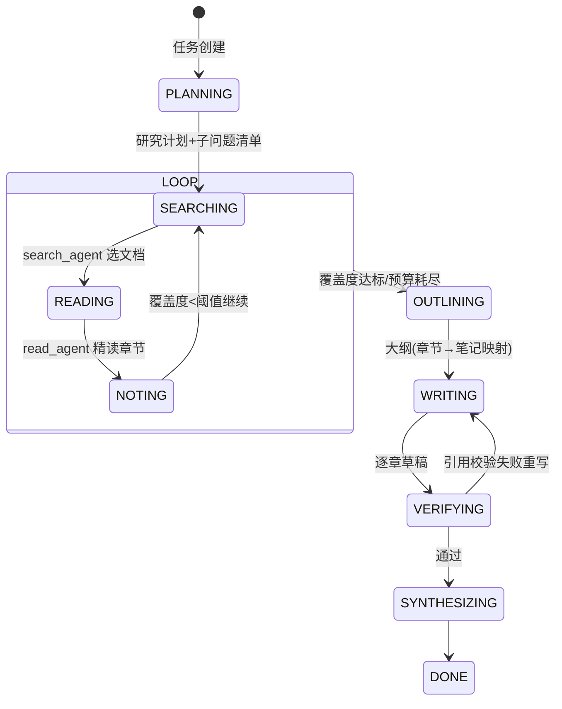
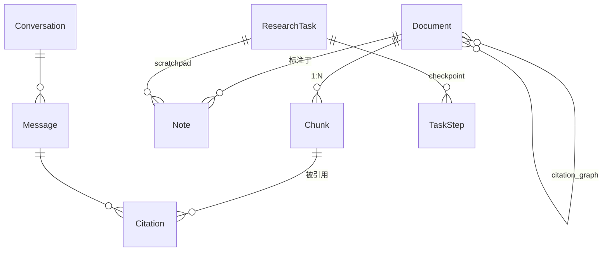

# Cortex —— 个人知识库问答 Agent（深度科研研究助手）技术架构设计

> 调研方向：技术架构
> 定位：单机可部署、个人开发者可维护、以"强引用溯源"为核心约束的科研文献问答与深度研究系统。
> 参考实践：PaperQA2（FutureHouse，agentic RAG + 引用校验，SOTA on RAG-QA Arena science）、gpt-researcher（planner + 并行执行 agent + 迭代深化）、Anthropic 多智能体研究系统（orchestrator-worker，token 成本约为普通对话 15 倍）、MinerU（版面/公式/表格解析）。

---

## 1. 总体架构



各层职责：

| 层 | 职责 | 关键决策 |
|---|---|---|
| 接入层 | 流式输出（SSE）、任务进度推送、鉴权（单用户 token） | FastAPI 单进程起步 |
| 应用层 | 会话管理、研究任务生命周期、文档入库 API | 无状态，业务逻辑薄封装 |
| Agent 编排层 | 工具调用循环、研究状态机、断点恢复 | LangGraph 图定义，checkpoint 落 SQLite |
| RAG 核心层 | 解析→切分→嵌入→索引；混合检索→重排→生成→引用校验 | 纯函数式 pipeline，可独立测试 |
| 模型服务层 | 统一 LLM/Embedding/Reranker 接口，按任务路由云端/本地 | OpenAI 兼容协议统一封装 |
| 存储层 | 原文 PDF、结构化元数据、向量、全文索引 | SQLite 起步，接口留 Postgres 迁移余地 |
| 可观测 | 每次调用 trace、token 成本、评估数据集回归 | Langfuse 自托管 |

## 2. 数据摄取流水线

```
PDF ──► 解析(MinerU / PyMuPDF快速通道) ──► 结构化JSON ──► 元数据补全 ──► 切分 ──► 嵌入 ──► 三路索引
        版面/公式/表格                    标题树+bbox     DOI/arXiv     section-aware  embedding  dense+sparse+BM25
```

- **解析**：主通道 MinerU（GPU/CLI 批处理，输出 Markdown+内容坐标 JSON，公式转 LaTeX、表格转 HTML）；CPU 或低配机器走 PyMuPDF 快速通道（纯文本层 PDF 足够，扫描件再回退 MinerU）。参考文献区单独解析（GROBID 或正则），只存不切，用于构建引文网络。
- **结构化**：每个内容块携带 `page_no`、`bbox`、`block_type`（text/formula/table/figure_caption）、所属标题路径，这是**引用溯源到页码的物理基础**。
- **语义切分（面向引用精度）**：section-aware chunking——沿标题层级切，正文块 400–600 token、重叠 15%；表格/公式整块独立成 chunk 并前置其 caption；每 chunk 元数据含 `section_path`、起止页码、字符 span。**宁小勿跨**：chunk 边界对齐段落，保证被引用时"引文即原文"。
- **嵌入与索引**：embedding 模型（Qwen3-Embedding-0.6B 或 BGE-M3，中英混合）→ Qdrant（稠密+稀疏双向量，HNSW m=16）；BM25 走 SQLite FTS5（分词：jieba 中英混合）。三路结果 RRF 融合。
- **元数据与去重**：DOI/arXiv ID 通过 CrossRef + Semantic Scholar API 补全（标题→作者/年份/venue）；去重三级：DOI 精确、simhash 近似、内容 sha256。增量更新由文件监听 + 入库任务表驱动，幂等重跑。

## 3. 检索与问答流水线

```
Query ─► 意图分类(小模型) ─► 改写扩展(多查询/HyDE) ─► 混合检索(dense+sparse+BM25, top-24 each)
      ─► RRF融合 ─► 去重(同doc相邻chunk合并) ─► Rerank(reranker, top-8)
      ─► 上下文组装(全局引用编号[n]) ─► 生成(内联[n]引用) ─► 引用校验pass ─► 呈现
```

- **查询理解**：意图分类（事实型/对比型/综述型/闲聊）决定检索深度与模型档位；改写用小模型生成 2–3 个变体（含中英互译），事实型可选 HyDE 生成假设答案辅助召回。
- **上下文组装**：按文档分组、保留标题路径与页码标注，每 chunk 分配全局编号 `[1]…[8]`，提示词强制"每个论断必须挂引用编号"。
- **引用校验层（独立 pass，参考 PaperQA2）**：对生成文本中每个 `[n]`，回查其主张 span 与 chunk 原文的支撑关系（字面重叠 + 小模型 entailment 判断）；校验失败→重试限定改写或降级为"不确定"表述；无引用的强论断→标记警告。这是"每个论断可回溯"的工程保证，而非仅靠 prompt 约束。

**溯源元数据链**：`Citation[n] → chunk_id → {doc_id, page_start/end, bbox[], char_span, section_path}` → 前端点击引用可高亮 PDF 对应页区域。

## 4. 深度研究 Agent 架构

参考 gpt-researcher 的"计划—迭代搜索—报告"与 Anthropic orchestrator-worker 模式，但**限制并行度（2–3 worker）、共享检索工具、每步落盘**，以控制 token 成本。



- **分工**：planner（强模型，生成子问题与终止条件）；search agent（小模型，只做检索+相关性粗判，输出压缩后的候选清单）；read agent（按 `read_paper` 工具精读目标章节，输出带 `[doc:section:page]` 锚点的结构化笔记写入 scratchpad 表）。planner 只见压缩笔记，不见原始检索结果——这是 Anthropic 博客的核心经验（子上下文隔离）。
- **笔记沉淀**：scratchpad 即结构化数据（claim + 引用锚点 + 置信度），大纲阶段把章节映射到笔记簇，撰写时逐章取用，天然可溯源。
- **事实一致性审查**：报告级 citation verification pass——逐条引文核验 + 跨章矛盾检测（同一实体不同结论列出并标注）。
- **中断恢复与进度**：状态机每步转移 checkpoint 到 `research_task.steps`（JSON payload），恢复时从最后完成步续跑；SSE 推送阶段级进度（"正在精读第 5/12 篇"）；设硬预算（最大步数/最大 token）防跑飞。

## 5. Agent 编排与工具设计

**取舍**：AutoGen/CrewAI 式自由多 agent 对话对个人开发者不可调试、token 翻倍；纯单 agent 工具循环无法支撑长研究任务的状态管理。**选择：LangGraph 轻量状态图**——QA 是单节点工具循环，深度研究是显式状态机，二者共享工具集；编排代码可在百行内自审，图结构即文档。

工具清单：

| 工具 | 签名要点 | 使用者 |
|---|---|---|
| `search_kb` | query, filters(year/venue/author), k → chunk 列表+锚点 | QA/研究 |
| `read_paper` | doc_id, section/page 范围 → 原文+坐标 | 研究精读 |
| `fetch_metadata` | doc_id/title/DOI → 文献元数据、引文列表 | 元数据核对 |
| `web_search` | 可选开关，弥补库内空白并标注"库外来源" | 研究 |
| `write_note` / `read_scratchpad` | 笔记 CRUD | 研究沉淀 |
| `verify_citation` | 主张 span + 引用号 → 校验结果 | 校验 pass |

## 6. 存储与数据模型



核心实体字段（摘要）：`Document(id, title, authors, year, venue, doi, source_hash, pdf_path, status, parser)`；`Chunk(id, doc_id, seq, text, section_path, page_start, page_end, char_span, bbox, block_type)`；`Citation(id, message_id/note_id, index_n, chunk_id, claim_span, verified, score)`；`ResearchTask(id, goal, state, budget_used, plan_json)`。

Qdrant payload 示例：

```json
{ "doc_id": "doc_0f3a", "chunk_seq": 42, "section_path": ["3 Method", "3.2 Alignment"],
  "page_start": 5, "page_end": 5, "char_span": [1024, 1580], "block_type": "text",
  "year": 2024, "venue": "NeurIPS", "lang": "en" }
```

图存储：MVP 阶段**不引入 Neo4j**，引文关系存 `document_references` 关系表，共引/引文网络分析（如"哪些论文都引用了 X"）用 SQL + 内存图算法即可；V2 若确有需求再迁 KùzuDB（嵌入式，无运维）。

## 7. 评估与可观测

- **检索指标**：golden set 上测 recall@8、MRR@10；分语言（中/英）、分 chunk 类型（表格/公式）切片报告。
- **生成指标**：引用正确率（引用编号指向的 chunk 确实支撑该论断的比例）、citation recall（应引用而未引用比例）、faithfulness（RAGAS）；深度研究另测覆盖率（子问题被回答比例）。
- **Golden set 构建**：起步 100 条——50 条从自己真实提问沉淀，30 条从论文摘要反向构造（摘要句 → 应命中的原文 chunk），20 条对比/综述型；每次索引或模型变更跑回归。
- **可观测**：Langfuse 自托管记录每次 trace（检索得分、prompt、token、延迟、模型档位）；成本看板按任务/会话聚合，深度研究任务设 token 硬预算告警。

## 8. 非功能设计

- **性能预估（1 万篇 ≈ 300k chunks）**：Qdrant HNSW top-24 <50ms（约 1.2GB 向量内存可全载）；FTS5 BM25 <100ms；CPU rerank 24→8 约 1–2s、GPU 约 200ms；端到端简单 QA 2–4s。摄取吞吐：MinerU GPU 约 1–2 页/s，1 万篇约 20–40 GPU 时，夜间批跑。
- **成本控制**：三级模型路由——意图分类/改写/相关性粗判/笔记整理用本地 Ollama（qwen3:8b）或廉价 API；最终生成与 planner 用强模型；语义缓存（query embedding 相似 >0.95 直接复用答案，个人库命中率可观）；深度研究预算上限默认单任务 200k token。
- **隐私**：本地优先——PDF 不出本机；可切"全本地模式"（Ollama + 本地 embedding/reranker），云端仅显式开启。
- **容错降级**：云端 API 超时/限流→自动切本地模型并标注降级；解析失败文档进死信表不阻塞批次；Qdrant 宕机→FTS5 纯 BM25 兜底检索。

## 9. 架构决策记录（ADR）

| # | 决策 | 理由 | 备选 | 风险与对策 |
|---|---|---|---|---|
| 1 | 混合检索（稠密+稀疏+BM25，RRF）优于纯向量 | 中英混合、专名/公式符号向量召回差 | 纯向量 | 多路延迟叠加→并行查询 |
| 2 | MinerU 主通道 + PyMuPDF 快速通道 | 引用精度依赖版面/页码；纯文本 PDF 无需重解析 | Docling/Marker | GPU 依赖→夜间批处理 |
| 3 | section-aware chunking，chunk 携带页码/bbox/span | 溯源到页码是硬需求，元数据必须摄取期生成 | 固定窗口切分 | 切碎语义→标题路径入 prompt |
| 4 | LangGraph 轻量编排，拒绝重型多 agent 框架 | 个人可调试；Anthropic 实测多 agent token 约 15 倍 | AutoGen/CrewAI | 图复杂化→状态机显式、每步可测 |
| 5 | 双通道模型路由（云端强模型+本地 Ollama） | 成本可控+断网可用+隐私 | 全云端/全本地 | 本地质量下降→仅低风险任务用本地 |
| 6 | 引用校验做成独立 pass 而非仅 prompt 约束 | PaperQA2 证明显式校验显著提升可信度 | 仅提示词约束 | 增加延迟→仅 QA/报告启用 |
| 7 | SQLite 起步 + Qdrant 容器，图库延后 | 运维成本最低，1 万篇规模绰绰有余 | Postgres+Neo4j 全家桶 | 并发写限制→单用户场景无碍 |
| 8 | 研究任务 checkpoint 落 SQLite | 长任务中断恢复是深度研究的刚需 | 内存态 | payload 膨胀→只存增量与指针 |
| 9 | 自建 citation 指标 + RAGAS 组合评估 | 通用指标测不出"引用正确率" | 仅 RAGAS | golden set 维护成本→100 条起步滚动增补 |
| 10 | 语义缓存 + 小模型前置路由 | 个人重复提问多，缓存与路由收益直接 | 全量走强模型 | 缓存陈旧→按 doc 版本失效 |

## 10. 演进路线

- **MVP（第 1–4 周）**：MinerU 解析 + section 切分 + 稠密检索 + 单路 QA（带页码引用，先不做校验 pass）+ Streamlit/FastAPI 最简界面；SQLite + Qdrant 两容器。验证核心价值：**引用可点、答案可信**。
- **V1（第 5–8 周）**：完整混合检索（+稀疏+BM25+rerank）、引用校验 pass、DOI 元数据与去重、Langfuse 追踪、100 条 golden set 回归、深度研究状态机的检索-阅读循环（不含报告合成）。
- **V2（第 9–12 周）**：完整深度研究 Agent（大纲→撰写→审查→合成、断点恢复、进度推送）、笔记沉淀与知识库回写、引文网络图增强（关系表 + 共引分析）、全本地降级模式打磨、成本看板。

演进原则：每阶段存储 schema 向前兼容（字段只增不改），模型接口从第一天就是双通道抽象，保证任何阶段可随时切换"全本地隐私模式"。

---

**主要参考来源**
- [PaperQA2 / future-house/paper-qa（GitHub）](https://github.com/future-house/paper-qa)、[PaperQA 论文（arXiv:2312.07559）](https://arxiv.org/html/2312.07559v2)、[FutureHouse: PaperQA2 SOTA on RAG-QA Arena](https://www.futurehouse.org/research-announcements/paperqa2-achieves-sota-performance-on-rag-qa-arena-science-benchmark)
- [Anthropic Engineering: How we built our multi-agent research system](https://www.anthropic.com/engineering/built-multi-agent-research-system)
- [gpt-researcher](https://github.com/assafelovic/gpt-researcher)（planner/执行 agent 分工与 breadth-depth 深化模式）
- [MinerU（opendatalab/MinerU，GitHub）](https://github.com/opendatalab/MinerU)（版面分析、公式识别、表格识别、Markdown/JSON 输出）
- [Document Parsing for Production RAG](https://medium.com/@manikandan_t/document-parsing-for-production-rag-architecture-tradeoffs-and-when-to-use-what-7a89ab0af7b7)、[12 款开源 PDF 解析工具对比](https://liduos.com/en/posts/ai-develope-tools-series-2-open-source-doucment-parsing)
